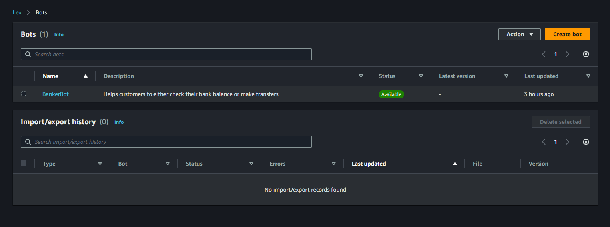
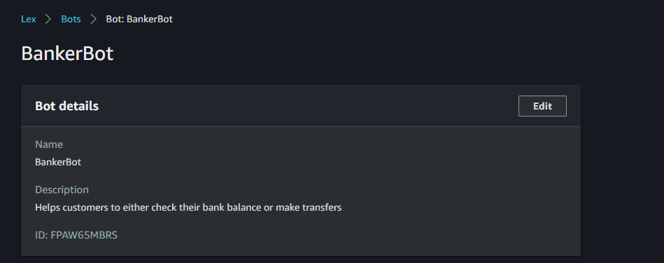
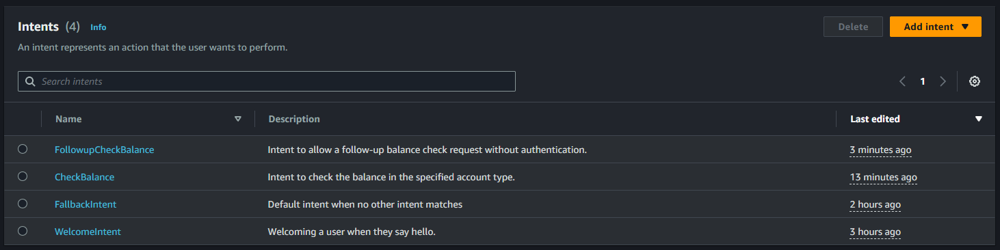
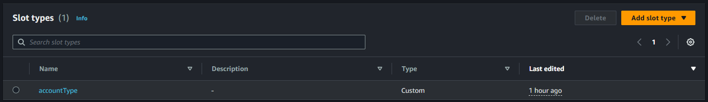
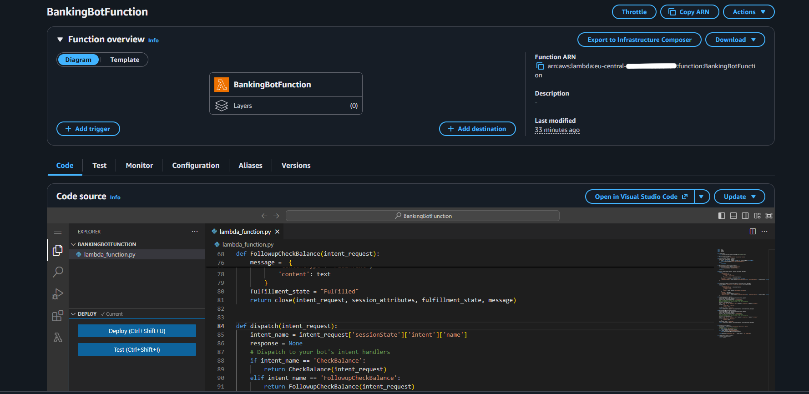

# Chatbot-on-AWS
Built a chatbot on AWS using Amazon Lex

A banking chatbot built on AWS using Amazon Lex and Lambda. It greets users and handles voice or text conversations. Customers ask for their savings or credit balance, and the bot verifies them by date of birth and remembers them for the rest of the session. Balances are randomly generated for demonstration.

## Demo
https://github.com/user-attachments/assets/5c16669f-1dff-4847-b8be-3a2aad8d1acf

## AWS services used
Amazon Lex: Understands what the customer wants(greeting, savings balance, credit balance), collects the DOB, and handles both voice and text.  
AWS Lambda: Fulfillment code that verifies, generates a random account balance, and stores the verified state in the session. 

[ Involved, but didn't set them up ]  
AWS IAM: roles that let Lex invoke Lambda Functions on my behalf  
Amazon CloudWatch: Lambda logs  

## Screenshots (Description):
S1: BankerBot bot in Amazon Lex, showing its Available status.  

  

S2: BankerBot’s configuration page in Amazon Lex, showing its name, description, and ID.  

  

S3: The four intents- WelcomeIntent for greetings, CheckBalance for balance requests, FollowupCheckBalance for verified follow-ups, and FallbackIntent for anything unrecognized.  

  

S4: The custom slot type I created to capture the customer's account type (savings or credit) from their request.  

  

S5: BankingBotFunction, the Python Lambda that routes each Lex intent to its handler and returns the balance response.  

  

## Key things I've learnt
- How Lex works: intents, utterances, and slots. I used slots to collect the customer's DOB and account type (savings or credit).  
- How Lex and Lambda work together: Lex handles the conversation, and Lambda functions handle the fulfillment logic.  
- Lex supports both Text & Voice on the same bot configuration.  
- Lex needs a role and permission to invoke Lambda functions, and a missing permission was a common cause of errors.

## Possible Improvement
- Store registered customers on **Amazon DynamoDB** so Lambda can verify and return actual balances instead of random ones.  

